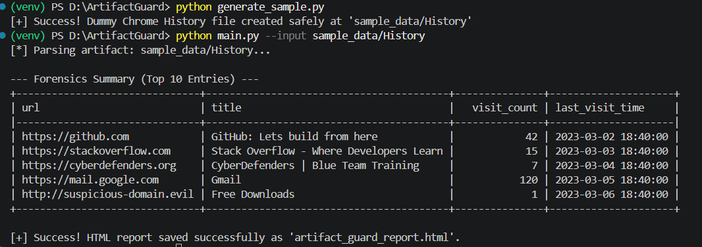

# 🛡️ ArtifactGuard

**ArtifactGuard** is an automated digital forensics triage tool designed to parse, analyze, and report on browser artifacts. Built for incident responders and forensic analysts, it extracts key user activity from SQLite-based browser history databases (such as Google Chrome and Brave) and generates clean, professional HTML audit reports alongside real-time terminal summaries.

---

## 🚀 Key Features

* **Automated SQLite Parsing:** Connects directly to Chromium-based `History` databases without requiring commercial forensic suites.
* **Timestamp Normalization:** Automatically converts cryptic Webkit/Chrome microsecond epochs into readable UTC timelines.
* **Dual Reporting Engine:** Displays a quick ASCII summary table directly in the terminal using `tabulate` while exporting a responsive, standalone HTML audit report for case documentation.
* **Modular Architecture:** Clean separation of concerns between database parsing logic and command-line execution/reporting.

---

## 📁 Project Architecture

    ArtifactGuard/
    │
    ├── assets/            # Contains terminal execution screenshots & preview media
    ├── sample_data/       # Secure storage for mock or triage test database files
    ├── parser.py          # Core forensic parsing engine & Webkit timestamp converter
    ├── main.py            # CLI controller, display engine, & HTML report generator
    ├── requirements.txt   # Project python dependencies
    └── README.md          # Project documentation & usage guide

---

## ⚙️ Prerequisites & Installation

1. **Clone the repository:**

        git clone [https://github.com/Srinjoy001-Gh/ArtifactGuard.git](https://github.com/Srinjoy001-Gh/ArtifactGuard.git)
        cd ArtifactGuard

2. **Create and activate a virtual environment:**

        python -m venv venv
        venv\Scripts\activate     # On Windows
        source venv/bin/activate  # On macOS/Linux

3. **Install dependencies:**

        python -m pip install -r requirements.txt

---

## 💻 Usage Instructions

Run the tool by pointing the `--input` argument to a target browser `History` database file:

        python main.py --input sample_data/History

* **Terminal Output:** Outputs an ASCII summary table directly in your terminal with visited URLs, visit counts, and normalized UTC timestamps.
* **HTML Audit Report:** Generates a professional report file named `artifact_guard_report.html` in your root folder. Open it in any web browser to view the formal audit document.

---

## 📸 Preview

---

## 🔮 Future Roadmap

- [ ] Add support for parsing browser `Downloads` and `Cookies` SQLite tables.
- [ ] Implement cryptographic hashing (SHA-256) on target evidence files for chain-of-custody verification.
- [ ] Expand triage support to multi-browser profiles.

---

## 👨‍💻 Author

**Srinjoy Ghatak**  
*B.Sc.-M.Sc. Forensic Science (Cyber Forensics) | NFSU*  
[GitHub Profile](https://github.com/Srinjoy001-Gh)